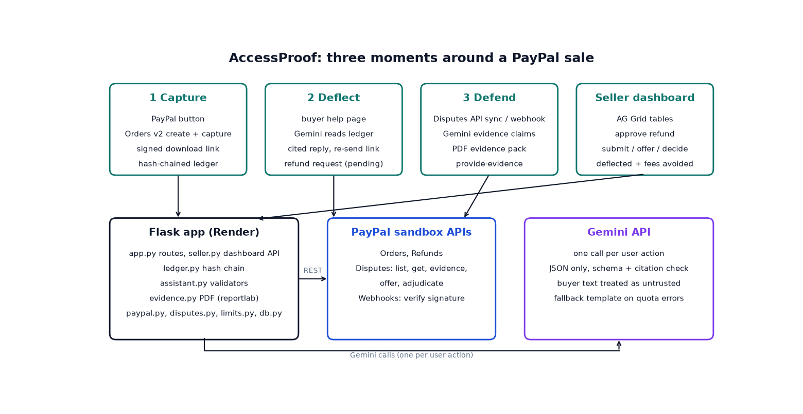

# AccessProof

AccessProof is a small web app for people who sell digital products through PayPal. It records proof that a buyer got their download, tries to settle "I never got it" complaints before they turn into disputes, and builds an evidence pack when a dispute does get opened.

Everything runs against the **PayPal sandbox**. No real money is involved and the code refuses to start if it is pointed at the live PayPal API.



## The problem

Digital goods have no tracking number. When a buyer says "I never received it", the seller has little to show.

- PayPal's Seller Protection (US terms from Jan 26, 2026) covers intangible goods only if the seller can show a system of record proving the item was sent to the buyer electronically (email, IP address and so on) or that the buyer received or accessed it. Significantly-not-as-described claims are not covered at all. Source: [PayPal Seller Protection](https://www.paypal.com/us/webapps/mpp/security/seller-protection).
- Losing a dispute costs the sale plus a dispute fee: $15 in the US, $30 for high volume sellers. Source: [PayPal merchant fees](https://www.paypal.com/us/business/paypal-business-fees).

Most small sellers never record any of this, so they cannot prove anything.

## How it works

1. **Capture.** The buyer pays with the PayPal button (Orders v2 create and capture). The app gives them a signed download link that expires in 7 days. Every step (purchase captured, link issued, link opened, file downloaded) goes into an append-only ledger with time, IP and user agent. Each row stores the hash of the row before it, so editing an old row breaks the chain.
2. **Deflect.** The order page has a conversational assistant (a greeting, quick replies, a typing indicator, suggested follow-up questions and cited event chips on each answer). The buyer's message, the last turns of the conversation and that order's ledger rows go to Gemini, which answers like a person: facts about the order come only from the record, general questions about the shop, the proof chain, refunds and disputes from a short set of facts in the prompt, and it can re-send a link. It can also suggest a goodwill refund, but nothing is refunded until the seller clicks Approve in the dashboard (Refunds API). Buyer text is treated as untrusted. Any event ids the reply cites must exist for that order, and a reply to a not-received complaint must cite at least one, otherwise it is thrown away. If the buyer clicks "That solved it", the dashboard counts one deflected dispute and an estimated $15 fee avoided.
3. **Defend.** Disputes come in through the Disputes API (sync button) or the `CUSTOMER.DISPUTE.CREATED` webhook (signature verified through PayPal before anything is processed). Gemini maps the ledger to the intangible goods rule and writes claims. Every claim has to cite ledger event ids, and code drops any claim that does not. A PDF evidence pack is built and the seller reviews it, then clicks Submit, which calls `provide-evidence`. Not-as-described disputes are flagged as not covered and steer the seller to make an offer. In the sandbox the seller can call the adjudicate endpoint to see an outcome.

## Built with

Python, Flask, sqlite3, requests, reportlab, Gemini API (`google-genai`), PayPal REST (Orders v2, Payments v2 refunds, Customer Disputes v1, Webhooks), AG Grid Community, PayPal JS SDK, Playwright (end-to-end checks and screenshots), gunicorn, Render.

## Run it locally

Needs Python 3.10+ and a PayPal sandbox REST app, plus a Gemini API key from Google AI Studio (the free tier is enough).

```bash
python -m venv .venv
.venv/Scripts/activate        # on Mac/Linux: source .venv/bin/activate
pip install -r requirements-dev.txt
python -m playwright install chromium
cp .env.example .env          # then fill in the values (see below)
python scripts/seed.py        # optional demo rows, marked "seed"
flask --app app run
```

Values for `.env`: the PayPal sandbox client id and secret, the sandbox buyer email and password (only `scripts/e2e.py` and `scripts/file_dispute.py` use these), `GEMINI_API_KEY`, `GEMINI_MODEL` (for example `gemini-3.5-flash-lite`; if it is empty or the model is unavailable, buyers get the template answer from their access record), `SELLER_PASSWORD` (any password you choose for the dashboard) and `APP_SECRET` (a random string of at least 16 characters, for example `python -c "import secrets; print(secrets.token_hex(32))"`). `PAYPAL_WEBHOOK_ID` is only needed once a webhook is registered. The app refuses to start without `APP_SECRET`.

Open http://localhost:5000. The seller dashboard is at `/login` (password from `SELLER_PASSWORD`).

Checks:

```bash
ruff check .
pytest -q
python scripts/e2e.py         # buys the product in the sandbox with the sandbox buyer account
python scripts/shots.py <order id>   # screenshots at desktop and phone size
```

Scripts in `scripts/`:

- `make_product.py` rebuilds the sample PDF in `products/`.
- `make_cover.py` redraws the product cover image in `static/`.
- `seed.py` adds demo rows marked `seed` and the recorded real sandbox dispute from `real_case.json` (buyer address scrubbed), so a fresh host can show it (`--if-empty` only seeds a fresh database; Render runs it that way; `--real-only` loads just that case).
- `e2e.py` buys the product in the sandbox with the sandbox buyer account and checks the download (and the ledger events too when `DB_PATH` points at the app's database).
- `shots.py` takes screenshots of every page at desktop and phone size and logs console errors.
- `file_dispute.py` files an "item not received" case as the sandbox buyer in the Resolution Center (set `FILING_TXN` to the transaction id from the Resolution Center URL).
- `register_webhook.py` registers the dispute webhook once the app has a public URL.

For webhooks, deploy first, then run `python scripts/register_webhook.py https://your-url` and set `PAYPAL_WEBHOOK_ID` on the host.

## Try it

- Live app: <RENDER_URL>
- Logins for the live demo (a PayPal sandbox buyer and the seller dashboard password) are provided with the project submission. To use your own, create a sandbox buyer in the PayPal developer dashboard and choose any `SELLER_PASSWORD` in `.env`.

Quickest path to the chat assistant: click "Judges: try the assistant without paying" on the store page (a demo order, no PayPal). Full path: buy the product with the PayPal button and a sandbox buyer, download the file, open "Problem with your order?" and type "I never got my download". Then log in at `/login` as the seller: the Access ledger tab shows each delivery event, Help requests shows the assistant's case, and Disputes lets you build an evidence pack and open the PDF.

The first request after a quiet period can be slow on a free Render instance, and its disk resets on deploys and after idle time, so run the steps in one sitting. A fresh instance starts from labelled seed data plus the recorded real sandbox case (`scripts/real_case.json`).

## What is real and what is sample

Real: the sandbox checkout and capture, the signed links and ledger, the Gemini replies and evidence drafts, the dispute list/get calls, `provide-evidence` on one real case, a seller-approved refund (`POST /v2/payments/captures/{id}/refund` returned `COMPLETED` for a sandbox purchase), the evidence PDF.

Not exercised against PayPal: make offer, the adjudicate call and webhook delivery (their code paths are unit tested with PayPal mocked).

Sample or seeded:
- Rows marked `seed` come from `scripts/seed.py` so the dashboard is not empty. Seed orders have fake capture ids and are blocked from every PayPal call.
- Rows marked `sample` come from the "Load sample dispute (not from PayPal)" button. They are shaped like PayPal's dispute response but do not exist at PayPal, so submitting evidence for them is disabled and says why.
- One real sandbox dispute (an "item not received" case filed by the sandbox buyer in the Resolution Center with `scripts/file_dispute.py`) was listed by the Disputes API (a new case can take a while to appear there), synced, given an evidence pack and submitted with `provide-evidence`. PayPal accepted it (HTTP 200) and the case went to `UNDER_REVIEW`; later syncs show `WAITING_FOR_BUYER_RESPONSE`. The dashboard shows this row first with a "Real · PayPal sandbox" badge; sample and seed rows carry their own badges.

## Limitations

- The OpenAPI file does not describe the JSON part of `provide-evidence`. The request the app sends (an `input` part with an `evidences` list plus the PDF as `evidence-file`) was accepted for that one dispute with the evidence type PayPal listed as requested from the seller (`PROOF_OF_FULFILLMENT`). The app takes the type from the dispute's `evidences` entry with source `REQUESTED_FROM_SELLER` (unit tested with a constructed dispute). Other evidence types and dispute stages are untested.
- The sandbox adjudicate call (`Simulate decision`) is only offered when PayPal returns the `adjudicate` link. The real dispute never had that link (its links were `self`, `accept_claim`, `send_message` and `escalate` in the latest sync), so the call is untested.
- No email is sent. The `DELIVERY_EMAIL_LOGGED` event only records that a link was issued for the payer's address, and the evidence pack says so.
- The ledger detects edits and deletions in the middle of a chain. The head hash is sent to PayPal with every new filing, which anchors the chain from then on (the one real case was filed before that existed); before filing, whoever owns the database could still rebuild the whole chain, and deleting the newest rows cannot be detected without a copy of the head held elsewhere.
- One seller, one password, one product. The rate limit and the dispute data live in one process and one sqlite file, so this is a demo, not a multi-tenant service.
- Free tier Gemini limits apply. On a quota or overload error the buyer gets a plain template answer from the access record and the evidence pack is built in code from the ledger events instead (the wording that goes to PayPal is always written in code from the events the model cites).
- The three stat cards on the dashboard leave out seed rows. "Fees avoided" is an estimate: each "That solved it" click counts as one avoided $15 dispute.
- "Link opened" and "File downloaded" are recorded from the same download request, so they are one access, not two independent proofs.
- The free Render disk resets on deploys and after idle time; a fresh instance starts from seed data plus the recorded real case in `scripts/real_case.json`.

## License

MIT, see [LICENSE](LICENSE).
